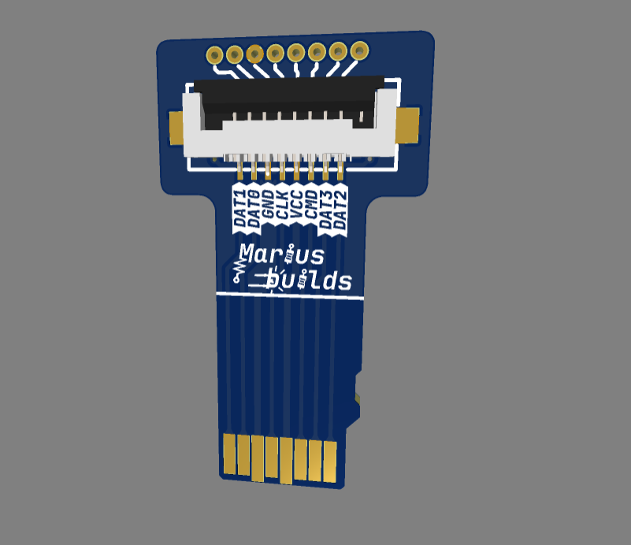
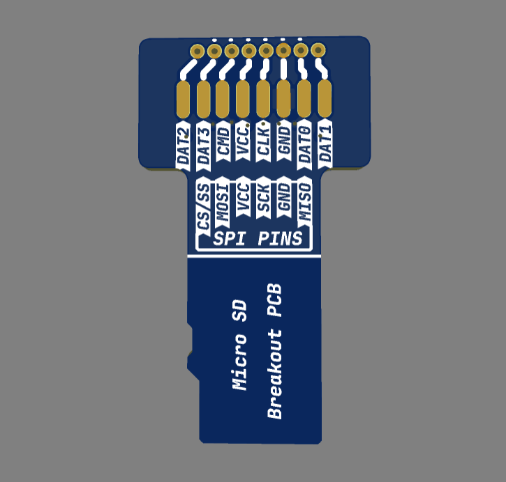

# MicroSD to FPC Breakout

A tiny PCB shaped like a microSD card. Push it into any **microSD slot** and the slot's signals come out on an **8-pin FPC connector** and a row of **solder pads**. Your device thinks it's talking to an SD card; it's actually talking to whatever you connected on the other end. Sneaky... but in a good way.

  
  

## What can you do with it? 

- **Extend an SD slot** that's hidden in an awkward place (3D printers, retro consoles, single-board computers, that one device where the slot is behind a screwed-on panel). Run an FPC cable to an SD socket where you can actually reach it.
- **Spy on the SD bus** with a logic analyzer or an oscilloscope while debugging. Clip onto the pads instead of trying to probe a card inside a slot.
- **Connect your own SPI device** to a microSD slot, or use the slot as a cheap, ready-made connector for a microcontroller project.
- **Save the slot's springs** – plug the adapter in once and swap cards on the other end, instead of wearing out a fragile built-in slot.

## MAIN FEATURES :

- **microSD-shaped PCB** with gold contacts that plug straight into a standard microSD slot.
- **8-pin FPC connector** (1.0mm pitch), so a flat cable can run wherever you need it.
- **8 solder pads** if you'd rather use plain wires or pin headers.
- **Both pinouts on the silkscreen**: the SD names (DAT0–DAT3, CMD, CLK) *and* the SPI names (CS, MOSI, SCK, MISO), so you don't need to look anything up.
- **One single component.** The BOM is shorter than this sentence.

## Pinout 

| Pin | SD mode | SPI mode |
|---|---|---|
| 1 | DAT2 | – |
| 2 | DAT3 | CS / SS |
| 3 | CMD | MOSI |
| 4 | VCC (3.3V) | VCC |
| 5 | CLK | SCK |
| 6 | GND | GND |
| 7 | DAT0 | MISO |
| 8 | DAT1 | – |

The pin order follows the standard microSD card pinout. The FPC connector and the solder pads carry the same eight signals; check the silkscreen for the order on each side.

## IMPORTANT INFORMATIONS ! 

1. **Order the PCB thin.** A microSD card is only about 0.7mm thick, so a standard 1.6mm PCB will not fit in the slot (no matter how hard you push – and please don't push). Choose a **0.6mm / 0.8mm** board thickness when ordering.

2. For best results, **choose ENIG (gold) surface finish.** The contacts slide in and out of a spring-loaded slot, and ENIG holds up much better than HASL. It also fits better, since HASL leaves uneven solder bumps on the pads.

3. **VCC is 3.3V** and it comes *from* the host slot. **Don't feed 5V back into it**, unless you're specifically trying to find out how much a new 3D printer mainboard costs.

4. **Keep the cable short.** SD cards run fast, and long flat cables don't love high-speed signals. If the card isn't detected or you get read errors, try a shorter cable first.

5. **Mind the cable type.** FPC cables come as **Type A** (contacts on the same side at both ends) and **Type B** (contacts on opposite sides). Pick the one that matches how the connectors face at each end of your setup.

## Parts you'll need

| Part | Component | Qty | LCSC |
|---|---|---|---|
| FPC connector, 8-pin, 1.0mm | JS AFA01-S08FCA-00 | 1 | C262755 |
| *Optional:* FPC cable, 8-pin, 1.0mm, Type A | JUSHUO JS10A-08P-100-4-8 | 1 | C2857571 |
| *Optional:* FPC cable, 8-pin, 1.0mm, Type B | JUSHUO JS10B-08P-100-4-8 | 1 | C2857786 |

Yes, that's the whole shopping list.

## License 

This project is licensed under [Creative Commons Attribution-ShareAlike 4.0 International](https://creativecommons.org/licenses/by-sa/4.0/).

In human words:
- ✅ **Share** – copy and redistribute it in any medium or format
- ✅ **Adapt** – remix, transform, and build upon it
- 🏷️ **Attribution** – give credit and link back here
- 🔁 **ShareAlike** – if you remix it, share your version under the same license

## Donate ☕

If you'd like to say thanks or buy me a coffee, a **[PayPal donation](https://www.paypal.com/donate/?hosted_button_id=KHR7DYJP2Z8QJ)** is always appreciated!

Have fun and enjoy it ! 😊
